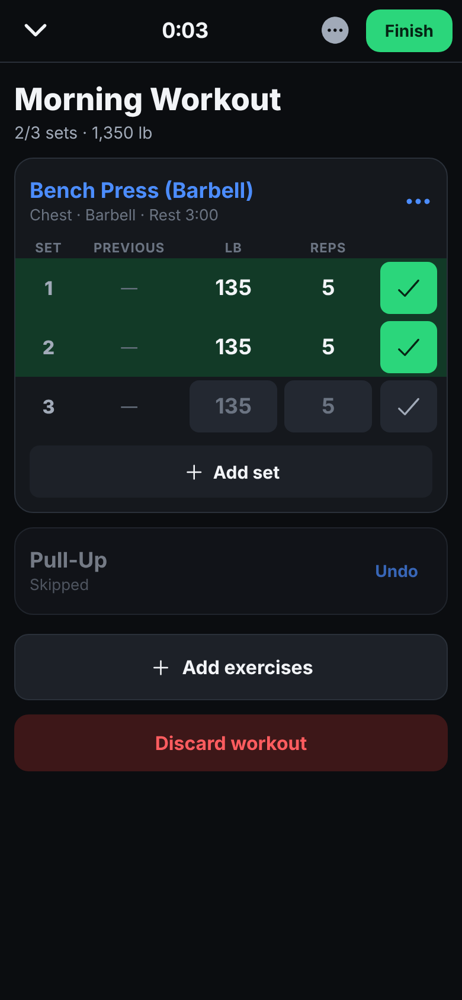
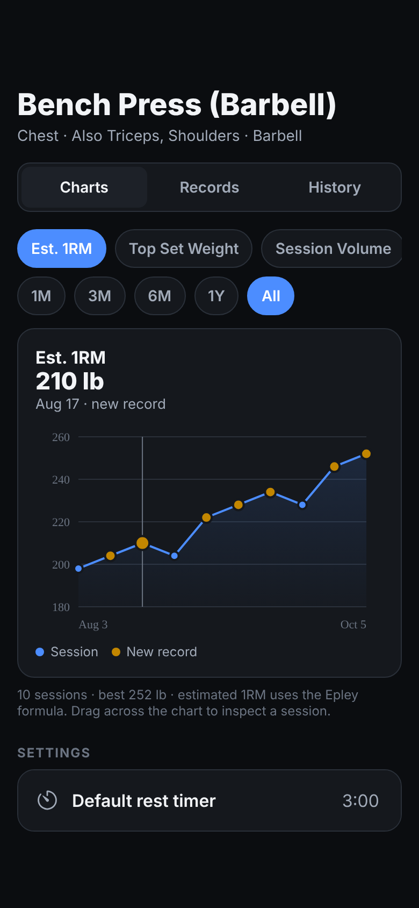
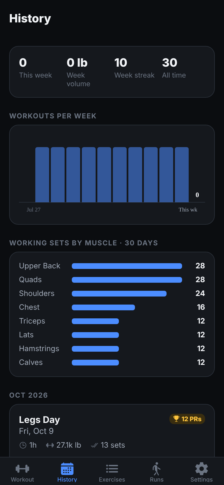
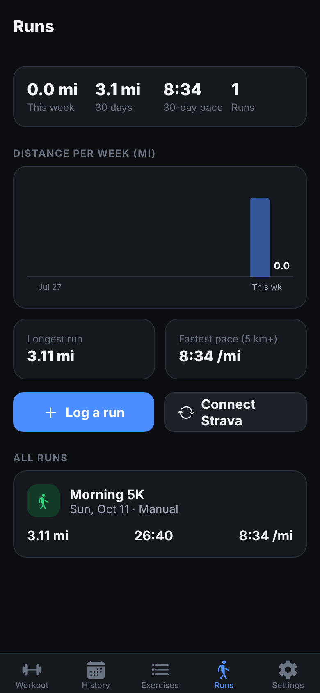

# IronLog

A personal workout tracker for iPhone, built with Expo (React Native) and TypeScript. It covers the Strong/Hevy lifting log, a Fitbod-style on-device plan generator, Strava run import, reminders, Apple Health and an Apple Watch companion. All data stays on the phone in SQLite: no account, no backend.

| Workout | Progress | History | Runs |
|---|---|---|---|
|  |  |  |  |

<sub>Screenshots are from the browser build at iPhone size; on the phone it uses native controls.</sub>

## Features

**Lifting**
- 134 preloaded exercises tagged by muscle group and equipment (barbell, dumbbell, machine, cable, bodyweight, kettlebell), plus your own custom exercises.
- Unlimited routines with sets × reps × weight and a rest time per exercise. Leave weight blank to reuse last session's.
- Active workout: sets are prefilled from the routine or your last session, so each set is one tap on ✓. You can add or delete sets; mark warm-up, drop or failure sets; skip, swap, reorder or remove exercises; and add notes. There's a warm-up ramp and a plate calculator, plus a "Previous" column like Strong's. The workout survives the app being closed.
- Rest timer per exercise. It starts when you check off a set and shows a big countdown with −15/+15/skip. In the app it plays a sound and vibrates; with the phone locked a notification does the alerting, and that also shows on an Apple Watch.
- Dark UI with 44–48 pt touch targets, a Done button on the number pad, and the screen kept awake during workouts.

**History and progress**
- Every workout is saved with date, duration, total volume and every set.
- PRs are detected automatically: estimated 1RM (Epley), heaviest weight, best set volume, and most reps for bodyweight moves. They're recomputed from full history whenever a workout is saved or deleted.
- Per-exercise charts for estimated 1RM, top set weight, session volume and best reps, with 1M/3M/6M/1Y/All ranges, drag-to-inspect and record markers. Each exercise also has a records page with a rep-max table.
- Workouts-per-week and sets-per-muscle charts, a week streak, and save-as-routine or update-routine-with-today's-weights.

**AI workout builder (on-device)**
- Inputs: goal (strength or hypertrophy), days per week, split, equipment, session length.
- Uses PPL, upper/lower, full-body or hybrid splits, with rest days placed between similar sessions.
- **Never trains the same primary muscle group on back-to-back days.** The generator enforces this and the screen verifies it.
- Varies exercises across the week and fits each session to the time you have. Suggests weights from your last 90 days.
- You can regenerate the whole week or one day, swap any exercise for a ranked alternative, adjust sets and reps, save as routines, and add reminders for each training day.

**Runs**
- Strava OAuth with your own API keys; imports Run, Trail Run and Virtual Run activities (distance, time, pace, elevation, heart rate).
- Log a run by hand (distance and time, with live pace). The Runs tab shows weekly distance, 30-day pace, longest run and fastest 5 km+, and runs also appear in History.

**Reminders.** Pick a routine (or any workout), weekdays and a time, and toggle each reminder on or off. Tapping the notification offers to start that routine.

**Apple Health.** Writes finished workouts (Traditional Strength Training) and manual runs, with an optional calorie estimate. Needs a development build.

**Apple Watch.** In Expo Go, rest-timer and reminder alerts show on the watch. With a development build there's a SwiftUI watch app: log the current set (adjust weight and reps on the wrist), run the rest timer with a wrist tap when it ends, start a routine, and finish the workout.

## Run it on your iPhone (Expo Go)

1. Install **Expo Go** from the App Store. This project targets **Expo SDK 57**.
2. On your computer, with Node 20 or newer:
   ```bash
   git clone https://github.com/asherniedzwiedz-sys/workout-app.git
   cd workout-app
   npm install
   npx expo start
   ```
3. Scan the QR code with the iPhone Camera; it opens in Expo Go. The phone and computer must be on the same Wi-Fi. If they can't see each other, use `npx expo start --tunnel` (that changes the Strava callback domain; see below).

Allow notifications when you start your first workout; the rest timer and reminders use them.

To try charts and PRs right away: **Settings → Load sample history** (only shown while you have no workouts).

If your Expo Go has moved to a newer SDK and won't open the project, upgrade it with `npx expo install expo@latest --fix`.

### What runs where

| Feature | Expo Go | Development build |
|---|---|---|
| Lifting, routines, history, charts, PRs, AI builder | ✅ | ✅ |
| Rest timer sound, vibration, lock-screen alert | ✅ (default alert sound) | ✅ (custom beep) |
| Strava import, manual runs | ✅ | ✅ |
| Reminders | ✅ | ✅ |
| Alerts on Apple Watch | ✅ | ✅ |
| Apple Health sync | — | ✅ |
| Apple Watch app | — | ✅ |

Expo Go only contains Expo's own native modules, so HealthKit and the watch app need a build of your own. In Expo Go the app detects this and hides or explains those options.

## Connect Strava

1. On strava.com go to **Settings → My API Application** and create an app (any name; the website can be anything).
2. In IronLog open **Settings → Strava**. It shows the exact **Authorization Callback Domain** to enter on Strava:
   - **Expo Go:** your computer's LAN address, e.g. `192.168.1.20`, because Expo Go redirects to `exp://<that address>:8081/--/strava-redirect`. Update it on Strava if your network changes. With `--tunnel`, use the tunnel host the screen shows.
   - **Development build:** `localhost`. The app uses `ironlog://localhost/strava-redirect`, and Strava always accepts localhost.
3. Paste your **Client ID** and **Client Secret**, then tap **Connect with Strava**. Your full run history imports. After that, **Sync Strava** on the Runs tab pulls new runs.

There's no server, so the authorization code is exchanged for tokens on the phone using your client secret. The secret and tokens are kept in the iOS Keychain. That's fine for a personal app, but don't ship this to other people with your secret inside.

## Build with Apple Health and the Apple Watch app

You need a Mac with Xcode 16+ and CocoaPods 1.16.2+, plus an Apple ID signed into Xcode.

1. Add your Apple Team ID to `app.json` (Xcode → Settings → Accounts, or developer.apple.com → Membership):
   ```json
   "ios": { "bundleIdentifier": "com.asherniedzwiedz.ironlog", "appleTeamId": "ABCDE12345", "supportsTablet": false }
   ```
   If that bundle ID is taken for your team, change it. The watch app's ID follows automatically (`<id>.watchkitapp`).
2. Generate the native project and run it on your plugged-in iPhone:
   ```bash
   npx expo prebuild -p ios --clean
   npx expo run:ios --device
   ```
   For a build that runs without your computer, use `npx expo run:ios --device --configuration Release`, or EAS: `npx eas-cli@latest build --profile preview --platform ios`. EAS needs a paid Apple Developer account.
3. Install the watch app from the iPhone's **Watch** app → My Watch → IronLog → Install. Or select the `IronLogWatch` scheme in Xcode (`xed ios`) and run it on the watch.
4. In IronLog: **Settings → Apple Health → Save workouts to Health**, and optionally enter your body weight for calorie estimates.

Notes:
- `plugins/withoutPushEntitlement.js` removes the remote-push entitlement that expo-notifications adds by default. IronLog only uses local notifications, and a free Apple ID can't sign push. Keep it first in the `plugins` list.
- Builds signed with a free Apple ID expire after 7 days; re-run to refresh.
- The watch app's Swift sources live in `targets/watch/`. `@bacons/apple-targets` links them into the Xcode project during prebuild, so edit them there, not in `ios/`.

## Project layout

```
src/app/           screens (expo-router): tabs, workout, routine, exercise, history, run, strava, reminders, ai-builder
src/components/    UI: exercise card + set rows, rest timer, charts (react-native-svg), pickers, sheets
src/domain/        pure logic with unit tests: workout state, PRs, 1RM, stats, generator, Strava mapping, watch protocol
src/db/            expo-sqlite schema/migrations and repositories
src/state/         zustand stores: active workout (persisted), rest timer, settings, exercise cache
src/services/      notifications, reminders, Strava, Apple Health (health.ios.ts), Apple Watch bridge, sound/haptics
src/data/          the preloaded exercise library
modules/watch-bridge/  local Expo module (Swift, WatchConnectivity) for the phone side of the watch link
targets/watch/     SwiftUI watchOS app
plugins/           local config plugin
```

## Development

```bash
npm test            # 91 unit/integration tests (Jest, jest-expo)
npm run typecheck   # TypeScript strict
npx expo start --web  # browser build; handy for quick UI checks
```

The tests cover set logging, PR detection, charts and stats, and the routine generator: the no-back-to-back rule is checked across 1,296 generated weekly plans. They also cover the Strava service, reminder scheduling, Health writes and the watch protocol, with fetch, notifications, HealthKit and the database mocked.

## Known limits

- Weights are in pounds. Run distance can be miles or km.
- The Swift parts (watch app and bridge) were checked by generating the Xcode project with `expo prebuild`. They have not been compiled or run on a device yet, so the first Xcode build may need small fixes.
- The watch app shows and drives the workout running on the phone; it doesn't record heart rate. Calories sent to Health are estimates from body weight.
- Strava runs aren't written to Apple Health, because the device that recorded them usually already has.
